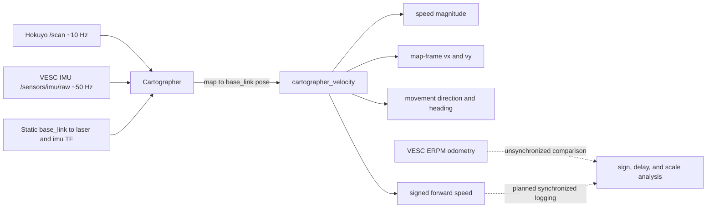

# Weekly F1TENTH Improvements - October 16-23, 2026

**Author:** Yiming Lu

**Platform:** F1TENTH, ROS 2 Humble, Linux

**Validation status:** The Cartographer motion estimator, its six output topics, and the
manual and powered tests described as completed below were run on the physical vehicle. The
VESC comparison is preliminary because the two streams were not recorded as a synchronized
dataset and no independent ground truth was available.

## Outcome

This week extended the Cartographer-based motion estimator from its first manual checks to
powered indoor driving. The node derives whole-vehicle motion from the continuously updated
`map -> base_link` transform and now provides:

| Topic | Quantity | Unit |
| --- | --- | --- |
| `/cartographer_velocity/speed` | Planar speed magnitude | m/s |
| `/cartographer_velocity/vx` | Map-frame X velocity | m/s |
| `/cartographer_velocity/vy` | Map-frame Y velocity | m/s |
| `/cartographer_velocity/movement_direction` | Velocity-vector direction | degrees |
| `/cartographer_velocity/heading` | Vehicle yaw from Cartographer | degrees |
| `/cartographer_velocity/forward_speed` | Signed velocity along the vehicle body axis | m/s |

The final real-car settings remain a `1.0 s` pose-history window and a `0.005 m/s`
deadband. The lower deadband retains a verified `0.0184 m/s` slow-motion case that the earlier
`0.025 m/s` threshold removed.

## Current architecture



Cartographer continues to own the dynamic `map -> odom -> base_link` chain. The estimator
reads the composed `map -> base_link` transform and publishes scalar motion signals; it does
not publish or compete for a TF link. VESC odometry remains a separate comparison source and
must use `publish_tf:=false` beside Cartographer.

## Code and change locations

| Location | Change | Reason |
| --- | --- | --- |
| `src/vehicle_state_estimator/vehicle_state_estimator/motion_math.py` | Added body-axis projection and wrapped direction-heading difference functions | Produce signed longitudinal speed and reproduce the field-test consistency diagnostic with testable pure math |
| `src/vehicle_state_estimator/vehicle_state_estimator/cartographer_velocity.py` | Added the sixth publisher, calculated forward speed, and logged the wrapped angular difference | Keep the repository interface aligned with the real-car validated node output |
| `src/vehicle_state_estimator/test/test_motion_math.py` | Added forward/reverse projection and angle-wrapping cases | Check the new numerical behavior independently of ROS 2 |
| `src/vehicle_state_estimator/package.xml`, `setup.py` | Bumped the package version from `0.1.0` to `0.2.0` | Record the added public output topic |
| `README.md`, `docs/OPERATIONS.md` | Updated architecture, topic list, test evidence, run commands, and VESC comparison plan | Keep setup and troubleshooting instructions synchronized with the current vehicle stack |
| `docs/research/2026-10-23-personal-research-journal.pdf` | Preserved the original weekly report | Keep the primary experiment record beside the implementation summary |
| `docs/research/2026-10-23-code-diff.patch` | Captured the exact text changes relative to the previous `main` | Make the weekly code and documentation delta directly reviewable |

## Implemented calculation

For two Cartographer poses `(x1, y1, t1)` and `(x2, y2, t2)`, the map-frame velocity and
speed magnitude are:

```python
vx = (x2 - x1) / (t2 - t1)
vy = (y2 - y1) / (t2 - t1)
speed = math.hypot(vx, vy)
movement_direction_deg = math.degrees(math.atan2(vy, vx))
```

Cartographer's quaternion provides heading `theta`. The new signed longitudinal speed is the
projection of map-frame velocity onto the vehicle's forward body axis:

```python
forward_speed = vx * math.cos(theta) + vy * math.sin(theta)
```

Positive values indicate motion along the vehicle's forward axis and negative values indicate
reverse motion. The field-test diagnostic wraps the angle difference so values remain within a
single revolution:

```python
difference_deg = (movement_direction_deg - heading_deg + 180.0) % 360.0 - 180.0
```

If speed is below `0.005 m/s`, the estimator publishes zero for speed, `vx`, `vy`, movement
direction, and forward speed. Heading still follows the latest Cartographer orientation.

## Why this change was needed

Speed magnitude alone cannot distinguish forward from reverse. Map-frame `vx` and `vy` also
change meaning as the track orientation changes. Projecting them onto the body heading provides
the signed longitudinal quantity needed for comparison with motor ERPM and for a later fusion
stage.

Movement direction and heading remain separate measurements. Their wrapped difference is a
useful forward-motion consistency check, but it can approach 180 degrees during reverse motion
and may differ during slip, lateral repositioning, or localization corrections.

## Physical-vehicle validation

### Sensor and transform inputs

| Input | Observed configuration |
| --- | --- |
| Hokuyo LiDAR | `/scan`, approximately 10 Hz |
| VESC IMU | `/sensors/imu/raw`, approximately 50 Hz |
| Cartographer pose | Continuously updated `map -> base_link` transform |
| Averaging window | 1.0 s |
| Speed deadband | 0.005 m/s |

### Manual forward and reverse checks

Manual translation produced speed values from rest through `0.0449`, `0.0734`, `0.1264`,
and `0.1859 m/s`. Signed forward speed reached approximately `+0.29 m/s` and `-0.33 m/s`,
confirming that the body-axis projection distinguishes forward and reverse motion.

### Powered remote-controlled test

In the representative 15-sample terminal sequence, moving speed ranged from `0.426` to
`0.726 m/s`. Thirteen of the fifteen displayed samples had a wrapped movement-direction and
heading difference within `+/-10 degrees`. Selected samples are preserved below:

| Speed | `vx` | `vy` | Movement direction | Heading | Difference |
| ---: | ---: | ---: | ---: | ---: | ---: |
| 0.564 | -0.534 | -0.182 | -161.23 deg | -154.57 deg | -6.66 deg |
| 0.609 | -0.280 | -0.541 | -117.37 deg | -108.26 deg | -9.11 deg |
| 0.726 | 0.233 | -0.687 | -71.23 deg | -62.36 deg | -8.87 deg |
| 0.630 | 0.494 | -0.391 | -38.39 deg | -37.63 deg | -0.76 deg |
| 0.467 | 0.353 | -0.306 | -40.86 deg | -39.02 deg | -1.84 deg |

These measurements establish responsive output and internal consistency. They are not an
absolute-accuracy result because no motion-capture system, encoder reference, or other
independent ground truth was recorded.

## Preliminary VESC comparison

The current VESC odometry configuration uses motor ERPM with the provisional
`speed_to_erpm_gain` value `4614.0`. In a forward-only check, VESC reported approximately
`-0.158` to `-0.295 m/s`, while Cartographer forward speed was positive. The forward signs
therefore need alignment.

Both measurements were a few tenths of a metre per second, but that order-of-magnitude
agreement is not a calibration result. The values were observed from unsynchronized output,
so delay, scale, bias, and residual statistics cannot yet be calculated.

## Build and run

```bash
cd ~/newf1_ws
colcon build --packages-select vehicle_state_estimator --symlink-install
source install/setup.bash
ros2 launch vehicle_state_estimator cartographer_velocity.launch.py
```

Inspect the six outputs in separate terminals or with a synchronized logger:

```bash
ros2 topic echo /cartographer_velocity/speed
ros2 topic echo /cartographer_velocity/vx
ros2 topic echo /cartographer_velocity/vy
ros2 topic echo /cartographer_velocity/movement_direction
ros2 topic echo /cartographer_velocity/heading
ros2 topic echo /cartographer_velocity/forward_speed
```

## Next experiment

1. Record raw ERPM, VESC odometry speed, Cartographer forward speed, and an independent
   distance/time reference with ROS timestamps.
2. Estimate time delay and align the forward sign before comparing amplitudes.
3. Use controlled measured-distance forward and reverse runs to replace the provisional gain
   with a regression-derived scale and bias.
4. Repeat runs to quantify uncertainty, then inspect residuals during turns and wheel slip.
5. Implement VESC-Cartographer fusion only after both sources are individually characterized.

The original Personal Research Journal PDF is stored beside this file. The patch file records
the exact repository text changes against commit `b0c7224`, the previous `main` baseline.
