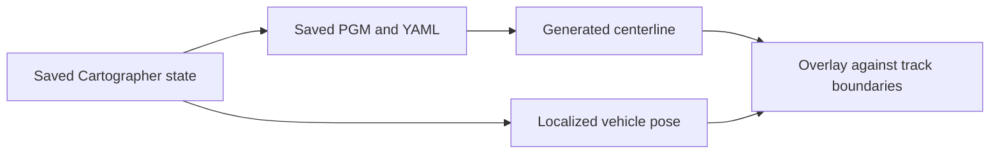

# Centerline-Localization Synchronization and Shared-State Planning

**Author:** Yiming Lu

**Report date:** November 13, 2026

The [original Research Journal](2026-11-13-research-journal.pdf) records a physical-vehicle check
under Linux. The November 6 investigation traced the centerline mismatch to products built from
different Cartographer mapping sessions. The November 13 work resolved it by generating the
centerline from the saved map and localizing against its matching state.

| Check | Reported result |
| --- | --- |
| Map provenance | The centerline and localization came from one mapping state. |
| Frame consistency | Both used the same map origin and orientation. |
| Geometric overlay | The localized pose and centerline were in the same mapped track region, with the centerline aligned to the track boundaries. |
| Upstream sensing and localization | The required sensor inputs and localization output operated normally after the correction. |

The report describes a qualitative single-vehicle verification. Absolute localization accuracy
and closed-loop controller actuation were outside the test scope. The report records no source-code
changes, so this archive entry contains documentation and the original PDF.

## Map provenance

Keep the state, map files and waypoint CSV together under one map version. Re-export the map
and regenerate the waypoints when the mapping state changes. Check provenance, origin,
orientation and the overlay before control. The [vehicle operations guide](../OPERATIONS.md#5-save-a-same-session-map)
records the save and verification steps.

## Proposed two-vehicle state exchange

| Proposed fields | Purpose |
| --- | --- |
| Vehicle identifier | Distinguish the local and remote vehicle. |
| Map identifier and frame | Match the saved map version and coordinate frame. |
| Position and heading | Describe each vehicle in common map coordinates. |
| Signed longitudinal speed | Compare relative motion using agreed units and sign. |
| Timestamp and validity | Identify stale or incomplete records. |

Each vehicle's local estimator remains the authority for its pose. The next experiment is to
assign an identifier to one saved map, agree on message fields and units, verify each vehicle's
localization on that map, then log one-way state exchange independently of control. A comparison
on a common timeline can measure delay and freshness. Transport, update rate, clock synchronization
and packet-loss behavior remain open, along with implementation and synchronized two-vehicle testing.
